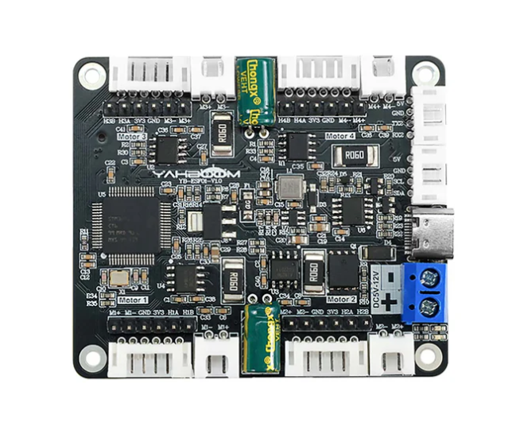
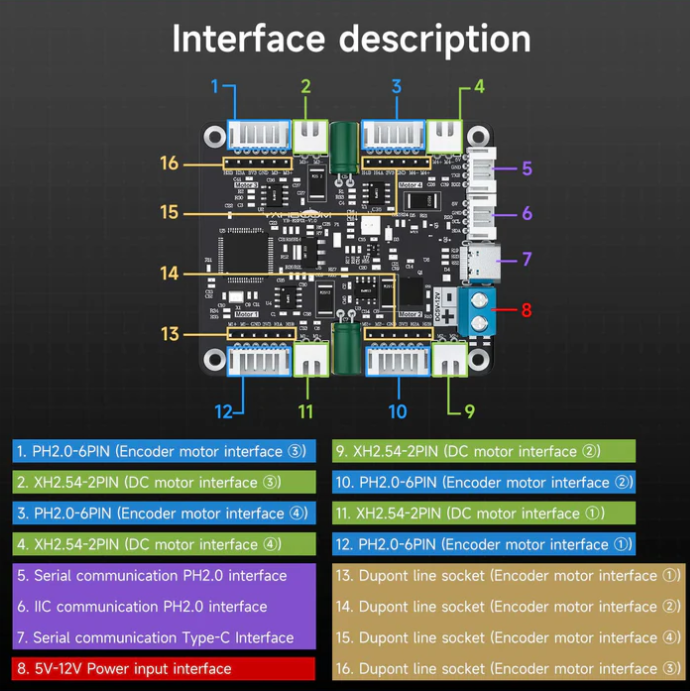
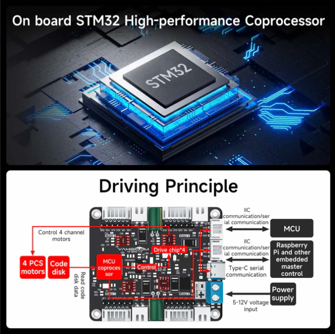
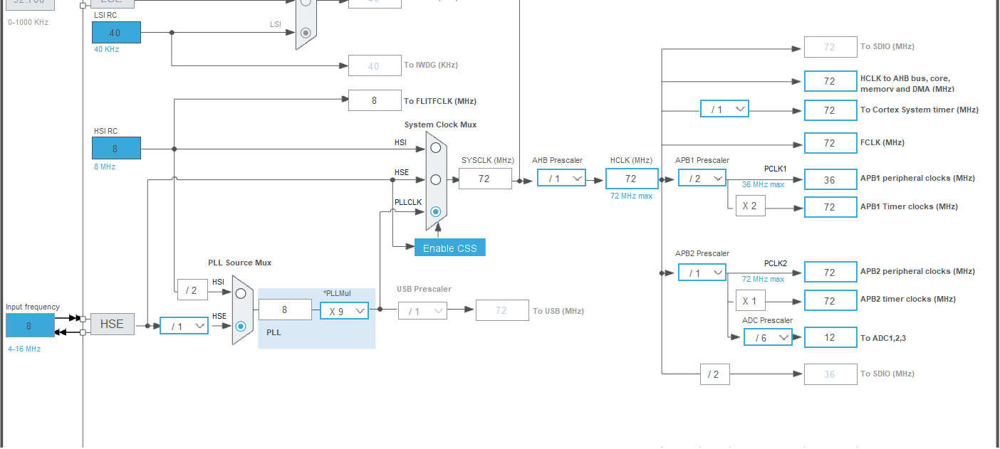
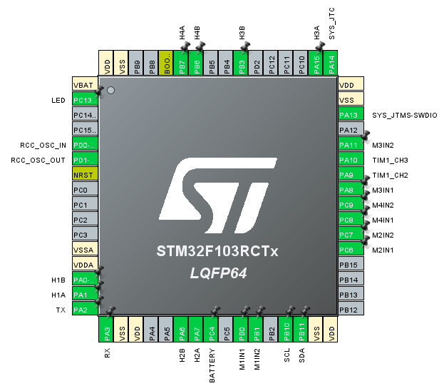

# Visao geral da placa

## Objetivo

Esta firmware controla 4 motores DC com encoder em uma base omni e fecha malha
de velocidade em `1 kHz`. A placa recebe comandos de velocidade do robo
(`vx`, `vy`, `omega`) pela serial, aplica limites de velocidade e aceleracao,
converte para velocidades individuais das rodas com a cinematica omni e aplica
um PI com compensacao de atrito em cada motor. Tambem aciona a placa do kicker
por `I2C2`.

## Fotos e referencias visuais

### Placa completa

### Interface externa

### Chip de acionamento

## Fluxo de controle

1. `main()` inicializa GPIO, DMA, ADC, `I2C2`, timers e `USART2`, inicializa a
   placa do kicker, aplica o baud do modo de comunicacao
   (`ApplyCommModeUartBaud()`), inicia o watchdog independente e carrega a
   identidade e os limites de movimento gravados na Flash.
2. `AppC_Init()` cria a aplicacao C++ e inicia PWM, encoders e calibracao do ADC.
3. `TIM6` interrompe a cada `1 ms` e chama `AppC_FastTick1kHz()`.
4. No fast tick:
   - verifica o timeout de comunicacao (`150 ms`) e entra em estado seguro se
     necessario
   - estima a rotacao do robo a partir dos encoders (janela anterior de 10 ms)
   - aplica o `AccelerationLimiter` ao comando `(vx, vy, omega)`, com transporte
     de referencial pela rotacao medida
   - converte para velocidade das rodas com `OmniKinematics` (teto comum de
     `500 RPM`, aplicado com um unico fator nas quatro rodas)
   - atualiza a medicao dos encoders, filtra o RPM e roda os 4 controladores
   - atualiza o PWM de cada motor
5. No loop principal:
   - processa recepcao serial por DMA circular e responde requisicoes
   - executa a maquina de estados da placa do kicker (`KickerBoard_Task()`)
   - atualiza leitura de bateria e heartbeat do LED
   - renova o watchdog independente

## MCU e perifericos

- MCU: `STM32F103RCTx`
- Encapsulamento: `LQFP64`
- Clock do sistema: `72 MHz` com cristal externo em `8 MHz` + `PLL x9`
- `TIM1` e `TIM8`: PWM dos motores
- `TIM2`, `TIM3`, `TIM4`, `TIM5`: interface encoder
- `TIM6`: base de tempo do controle em `1 kHz`
- `USART2`: comunicacao serial, `9600` baud (bench e AirPort Team) ou `420000`
  baud (match CRSF)
- `ADC1` canal `IN14 / PC4`: leitura da bateria
- `I2C2` em `PB10/PB11`, `100 kHz`: placa do kicker (endereco 7 bits `0x42`)
- `IWDG`: watchdog independente, cerca de `1,5 s`

## Arvore de clock

Configuracao atual do CubeMX:

- `HSE = 8 MHz`
- `PLL source = HSE`
- `PLL multiplier = x9`
- `SYSCLK = 72 MHz`
- `AHB = 72 MHz`
- `APB1 = 36 MHz`
- clocks efetivos dos timers em `APB1 = 72 MHz`
- `APB2 = 72 MHz`
- clock do ADC = `12 MHz` com prescaler `/6`

Impacto direto no firmware:

- `TIM1` e `TIM8` usam clock de `72 MHz`, o que leva a PWM de `30 kHz` com `ARR = 2399`
- `TIM6` usa prescaler `71` e periodo `999`, gerando a interrupcao de `1 kHz`
- os timers de encoder tambem operam com base de `72 MHz`

## Mapeamento dos motores

Ordem eletrica usada no firmware (`app.cpp`) e na cinematica:

| Motor logico | Posicao | Angulo da roda | Conector da placa | PWM | Encoder |
| --- | --- | ---: | --- | --- | --- |
| `M1` | frente-direita | `30°` | `M2` | `TIM8 CH1/CH2` (`PC6/PC7`) | `TIM3` (`PA6/PA7`) |
| `M2` | frente-esquerda | `150°` | `M4` | `TIM8 CH3/CH4` (`PC8/PC9`) | `TIM4` (`PB6/PB7`) |
| `M3` | traseira-esquerda | `225°` | `M3` | `TIM1 CH1/CH4` (`PA8/PA11`) | `TIM2` (`PA15/PB3`), invertido |
| `M4` | traseira-direita | `315°` | `M1` | `TIM1 CH2/CH3` (`PA9/PA10`) + `CH2N/CH3N` (`PB0/PB1`) | `TIM5` (`PA0/PA1`) |

Os angulos sao medidos no sentido anti-horario a partir de `+x` (direita), com
`+y` para frente. O encoder do conector `M3` (motor logico `M3`) e invertido
por software para casar com a orientacao fisica no robo.

A associacao entre timer e conector segue a nomenclatura da placa YahBoom
(conector `M1` = `TIM1 CH2/CH3` + `TIM5`, `M2` = `TIM8 CH1/CH2` + `TIM3`,
`M3` = `TIM1 CH1/CH4` + `TIM2`, `M4` = `TIM8 CH3/CH4` + `TIM4`). Se a fiacao
das rodas mudar, atualize `App::App()` em `app.cpp` e esta tabela juntos.

## Pinagem geral

Pinos usados pelo firmware alem dos motores e encoders:

- `PC13`: LED
- `PD0` e `PD1`: oscilador externo `HSE`
- `PA2/PA3`: `USART2 TX/RX`
- `PC4`: bateria em `ADC1_IN14`
- `PB10/PB11`: `I2C2 SCL/SDA` (placa do kicker)
- `PA13/PA14`: `SWDIO/SWCLK`

Pinos livres ou nao usados nesta firmware permanecem sem funcao aplicada no `.ioc`.

## Organizacao do firmware

O codigo de aplicacao esta dividido por responsabilidade:

- `main.c`: inicializacao gerada pelo CubeMX, laco principal e callbacks HAL;
- `app_c_api.cpp`: interface C/C++, tick de 1 kHz, comandos e estado seguro;
- `app.cpp`: controle dos motores, bateria e protecoes;
- `acceleration_limiter.cpp`: limites de velocidade e aceleracao cartesianos;
- `omni_kinematics.cpp`: conversao entre velocidade do robo e rodas;
- `motor.cpp` e `encoder.cpp`: acesso aos timers de PWM e de encoder;
- `pid_autotune.cpp`: autoajuste dos ganhos do PID;
- `serial_protocol.c`: constantes do protocolo, CRC e codificacao little-endian;
- `serial_service.c`: DMA da UART, parser, comandos, configuracao e telemetria;
- `match_control.c`, `crsf_protocol.c` e `robot_command.c`: modo de partida
  (frame de time, canais CRSF e comando seguro);
- `kicker_board.c`: protocolo I2C da placa do kicker;
- `robot_identity.c`: UID, validacao do ID e persistencia na Flash;
- `firmware_runtime.c`: servicos basicos de execucao, atualmente o watchdog.

Novas regras de protocolo devem ficar em `serial_protocol`; o transporte e o
despacho ficam em `serial_service`; acesso a Flash da identidade deve ficar em
`robot_identity`. O `main.c` apenas coordena os modulos e os perifericos
configurados pelo CubeMX.

## Parametros atuais

### Rodas e PID

- PWM: `30 kHz` (`ARR = 2399`)
- Encoder:
  - `11 PPR`
  - quadratura `x4`
  - reducao `18.8:1`
  - contagens por volta da roda: `827.2`
- Medicao de RPM: contagens acumuladas em janela de `10 ms` (cerca de
  `7,25 RPM` por contagem), seguidas de um biquad passa-baixa de cerca de
  `20 Hz` rodando a `1 kHz`
- PID (iguais nas quatro rodas):
  - `Kp = 17.6991`
  - `Ki = 80.2681`
  - `Kd = 0.001` (derivada sobre a medicao)
- Compensacao de atrito somada a saida do PID: `425` de PWM com a roda parada
  (`|RPM| < 3`) e `40` com a roda em movimento
- Anti-windup considera a saida final, incluindo a compensacao de atrito
- Saturacao da saida: `-2399` a `2399`
- Referencias com modulo menor que `3 RPM` zeram a saida e o integrador
- Limite de setpoint: `500 RPM` no caminho cartesiano (cinematica) e
  `+/- 530 RPM` no modo direto de bancada

### Geometria

Definida em `Core/Inc/robot_config.h`:

- raio da roda: `ROBOT_WHEEL_RADIUS_M = 0.03175 m`
- distancia do centro a roda: `ROBOT_CENTER_WHEEL_DISTANCE_M = 0.07715 m`

Com o teto de `500 RPM` por roda, a translacao pura satura acima de cerca de
`1,9 m/s` para frente e `2,35 m/s` para o lado. Quando ha saturacao, o fator
comum reduz tambem a parcela de rotacao.

### Configuracao de movimento

Os valores de `Core/Inc/robot_config.h` sao os defaults de fabrica. A aceleracao
linear e angular pode ser ajustada por placa via serial no SSL Configurator e
fica persistida junto da identidade na Flash. Se a configuracao persistente for
invalida, o firmware volta aos defaults compilados.

| Parâmetro | Unidade | Padrão | Função |
| --- | --- | --- | --- |
| `ROBOT_MAX_LINEAR_ACCEL` | m/s² | `4.0` | limita a variação vetorial de `(vx, vy)` |
| `ROBOT_MAX_ANGULAR_ACCEL` | rad/s² | `10.0` | limita separadamente a variação de `omega` |
| `ROBOT_MAX_BRAKE_ACCEL` | m/s² | `7.0` | permite desaceleração linear maior durante frenagem |
| `ROBOT_MAX_LINEAR_SPEED` | m/s | `2.5` | limita a norma de `(vx, vy)` no `AccelerationLimiter` |
| `ROBOT_MAX_ANGULAR_SPEED` | rad/s | `8.0` | limita `omega` no `AccelerationLimiter` |

O limitador é atualizado a `1 kHz`, antes de `OmniKinematics`. Detalhes e
resultados dos testes em [Controle omnidirecional e validação](omni-motion-validation.md).

## Protecoes

- Comunicacao: sem comando novo por `150 ms`, o firmware zera os setpoints,
  ativa o freio, limpa os PIDs e a rampa de velocidade, cancela chutes ainda
  nao enviados e pede parada segura a placa do kicker.
- Bateria: subtensao confirmada apos tres leituras abaixo de `9,6 V`, liberada
  acima de `10,2 V`; enquanto ativa, os setpoints sao zerados e o freio aplicado.
- Encoder: se uma roda recebe PWM `>= 650` e mede `<= 2 RPM` por `300 ms`
  seguidos, a saida dessa roda e cortada e a falha aparece no `status` da
  telemetria.
- Entradas invalidas (`NaN`/`Inf`) levam a parada segura.
- Watchdog independente (`IWDG`) reinicia a placa se o laco principal travar.

## Bateria

- Entrada analogica: `PC4`
- Referencia ADC: `3.3 V`
- Resolucao: `12 bits`
- Divisor resistivo modelado como:
  - parte alta `10 kohm`
  - parte baixa `3.3 kohm`
- ganho aplicado no software: `(10 + 3.3) / 3.3 = 4.03`
- taxa de atualizacao: `100 ms`

## Modos de parada

Quando o comando de um motor e zero:

- `brake_mode = 0`: coast, PWM zerado nos dois lados
- `brake_mode = 1`: brake, dois lados em nivel alto

## LED

O LED em `PC13` alterna estado a cada `200 ms`, servindo como heartbeat da firmware.
